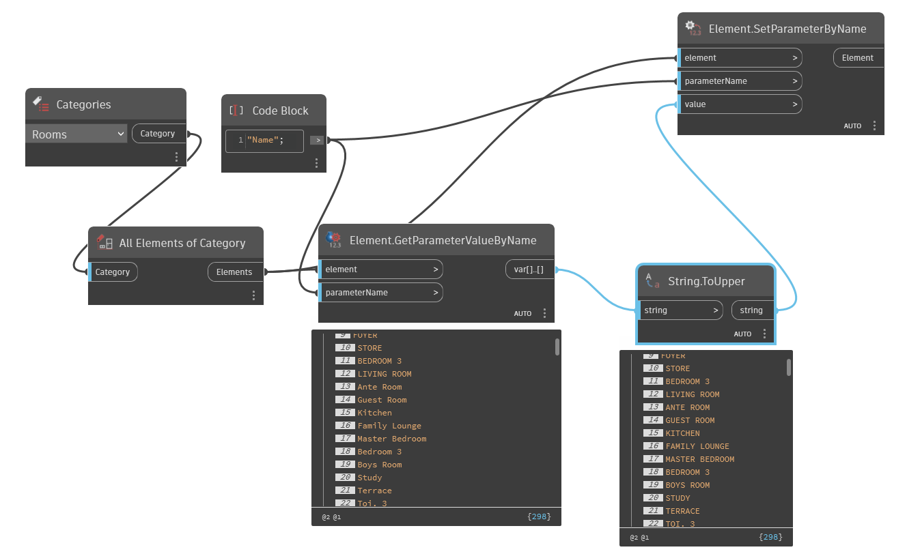

# Revit BIM Automation Tools
A collection of Dynamo and Python scripts designed to eliminate repetitive manual documentation, enforce BIM QA/QC standards, and accelerate architectural delivery.

---

## 01. Batch Room & Sheet Name Standardizer
* **Problem:** Manually auditing and standardizing capitalization across 200+ room tags and drawing sheets takes 30–45 minutes per project submission and introduces human typos.
* **Solution:** A 6-node Dynamo script that queries all Room/Sheet elements from the Revit database, transforms string parameters to office-standard uppercase, and writes the updates back to the model in a single transaction.
* **Impact:** Reduced standardization time from ~30 minutes to under 2 seconds across 200+ rooms.

### Dynamo Graph

